<div align="center">



<a href="https://git.io/typing-svg">
  
</a>

<br/>


<br/>

[](mailto:kiel.lennan13@gmail.com)
[](https://www.linkedin.com/in/kiel-lennan-cabungcal-906756396/)
[](https://github.com/PomPomiiiii)

</div>

---

## 👨‍💻 About Me

I build mobile and web applications across the full stack: frontend interfaces, backend services, APIs, and databases. My experience spans **Flutter**, modern web technologies, and enterprise development with the **.NET** ecosystem. I like turning ideas into clean, maintainable, user-friendly software that solves real problems.

```dart
class KielCabungcal extends Developer {
  final role      = 'Full-Stack Flutter Developer';
  final focus     = ['Cross-platform mobile', 'Full-stack web apps'];
  final stack     = ['Flutter', 'React', 'Node.js', 'C#/.NET', 'Firebase', 'SQL'];
  final exploring = ['AI integrations', 'Interactive 3D web'];
  final location  = 'Philippines 🇵🇭';

  @override
  String get mission => 'Clean interfaces. Maintainable code. Practical solutions.';
}
```

---

## 🛠️ Tech Stack

<div align="center">

**📱 Mobile**<br/>


**🎨 Frontend**<br/>

&nbsp;

**⚙️ Backend**<br/>


**🗄️ Databases & Tools**<br/>

<br/>


</div>

---

## 🚀 Featured Projects

<table>
<tr>
<td width="50%" valign="top">

### ☕ Café Scout
*AI-powered café discovery*

Location-based café search with Google Maps and a Gemini-powered chat assistant.

- 📍 GPS-based discovery
- 🔎 Filter by rating & distance
- 🤖 Gemini AI assistant


[🌐 **Live Demo**](https://cafe-scout-ten.vercel.app/) · [💻 **Code**](https://github.com/PomPomiiiii/Cafe-Scout)

</td>
<td width="50%" valign="top">

### 🪐 Solar Explorer
*Interactive 3D solar system*

An immersive experience covering all eight planets with cinematic animation and detailed planetary info.

- 🌌 Interactive 3D planets
- 🎞️ Animated scroll & transitions
- ✨ Rich visual presentation


[🌐 **Live Demo**](https://solar-explorer-six.vercel.app/) · [💻 **Code**](https://github.com/PomPomiiiii/Solar-Explorer)

</td>
</tr>
<tr>
<td width="50%" valign="top">

### 🧋 Sip Studio
*Full-stack drink customizer*

Multi-step ordering flow with live drink preview, receipts, and persistent order storage.

- 🧩 Eight-step customization
- 👀 Live visual preview
- 🧾 Order summaries saved to SQL Server


[🌐 **Live Demo**](https://sip-studio-delta.vercel.app/) · [💻 **Code**](https://github.com/PomPomiiiii/Sip-Studio)

</td>
<td width="50%" valign="top">

### 🏠 RentEase
*Location-based rental finder (capstone)*

Android app helping users discover rental properties in Lipa City.

- 🗺️ GPS-enabled property discovery
- 🏘️ Property listings
- 💬 Landlord ↔ tenant messaging


*Capstone project*

</td>
</tr>
</table>

<details>
<summary><b>🏢 Training Management System</b> — Enterprise portal built during internship <i>(click to expand)</i></summary>
<br/>

An internal training portal supporting administrative file uploads and employee document access.

- 📁 Administrative file management
- ⬇️ Employee file viewing and downloading
- 🔐 Cookie-based authentication and session management


*Internship project — source may be restricted.*

</details>

---

## 💼 Experience

**Software Development Intern** — *Sophies Information Technology Inc.* · `Jan – Apr 2026`

- Developed enterprise web applications using **C#/.NET 9** and **Blazor WebAssembly**
- Built and customized **WordPress** websites
- Implemented **cookie-based authentication** and session management
- Collaborated with developers following professional coding standards and software architecture practices

---

## 🏆 Certifications & Achievements

| | Achievement | Issuer | Date |
|---|---|---|---|
| 🥈 | **2nd Place** — TRON 2026 Cyber Defense Exercise Challenge | TRON 2026 | 2026 |
| 📜 | JavaScript | freeCodeCamp | Jul 2026 |
| 📜 | Foundational C# with Microsoft | freeCodeCamp | Apr 2026 |
| 📜 | Responsive Web Design | freeCodeCamp | Dec 2025 |
| 📜 | Introduction to SAP S/4HANA using Global Bike | SAP University Alliances | — |

## 🎓 Education

**B.S. in Information Technology** — STI College Lipa · `2022 – 2026`

---

## 📊 GitHub Stats

<div align="center">


### 🐍 Contribution Snake

<picture>
  <source media="(prefers-color-scheme: dark)" srcset="https://raw.githubusercontent.com/PomPomiiiii/PomPomiiiii/output/github-snake-dark.svg"/>
  <source media="(prefers-color-scheme: light)" srcset="https://raw.githubusercontent.com/PomPomiiiii/PomPomiiiii/output/github-snake.svg"/>
  
</picture>

</div>

---

## 🤝 Let's Connect

I'm interested in building useful software, collaborating with other developers, and creating impactful applications. If you're hiring or have something interesting to build, feel free to reach out.

<div align="center">

[](mailto:kiel.lennan13@gmail.com)

<br/>


</div>
